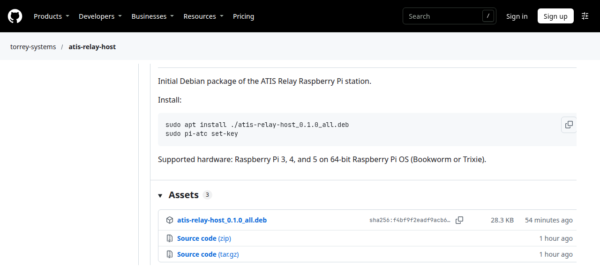
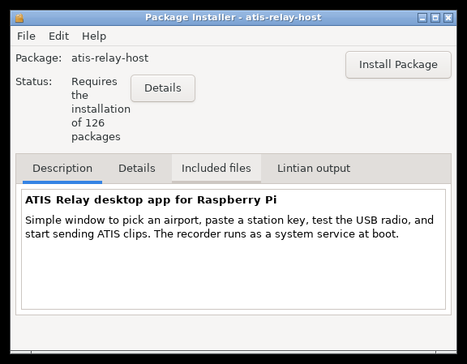
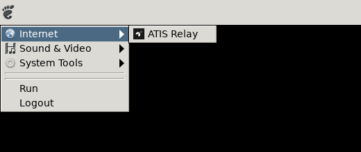
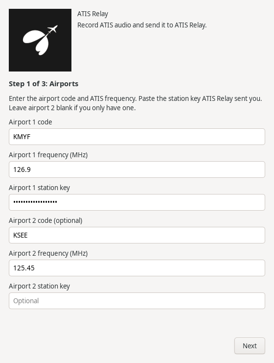
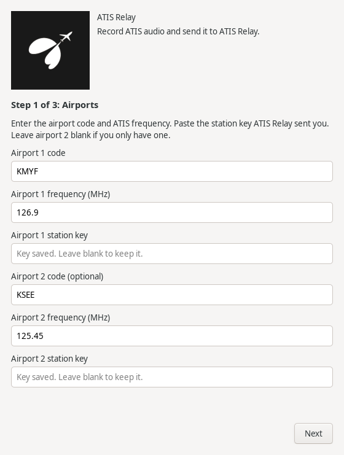
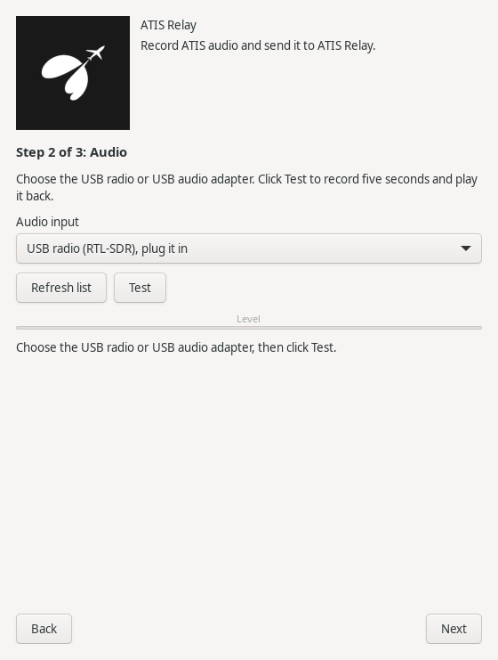
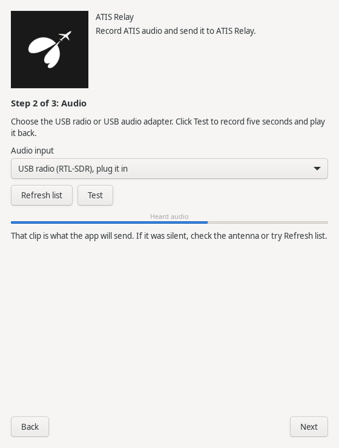
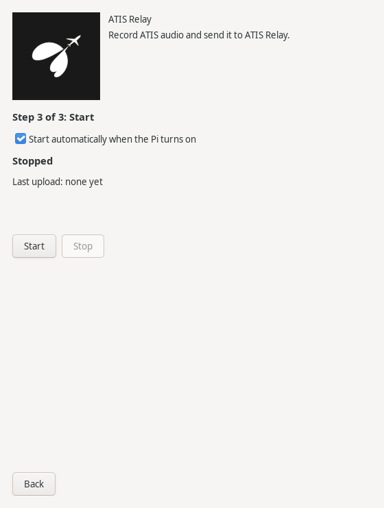
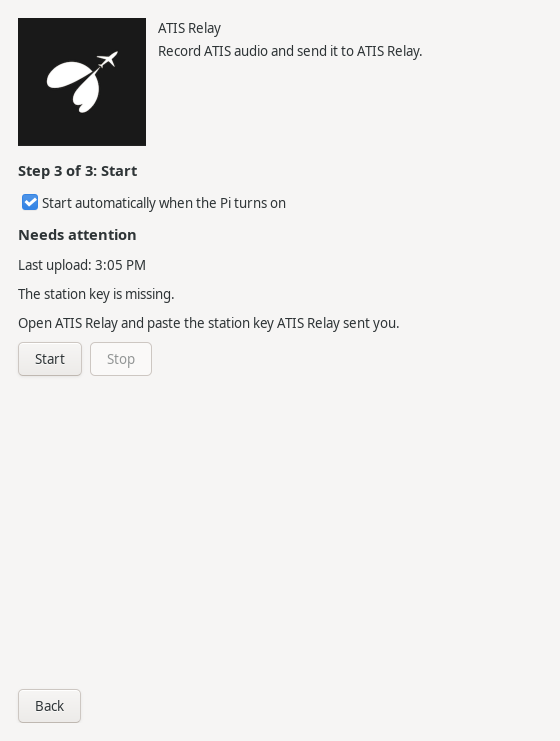

# ATIS Relay


Record aviation ATIS audio on a Raspberry Pi and send unique clips to ATIS Relay. This is a desktop app. You do not need the terminal after install.

Supported hardware: Raspberry Pi 4 or 5 on 64-bit Raspberry Pi OS desktop (Bookworm). An RTL-SDR USB radio is the usual audio source. A USB audio adapter also works.

The installer starts a background recorder. It runs at boot even if nobody signs in, and it restarts if it crashes.

## 1. Download the package

On a computer, open the [Releases](https://github.com/torrey-systems/atis-relay-host/releases) page and download `atis-relay-host_0.2.0_all.deb`. Copy that file onto the Pi (USB stick or the Downloads folder).



That screenshot is a real Releases page for this public org repo. The row that names who published the tag is cropped out so this guide has no account names.

## 2. Double-click to install

On the Pi, open the `.deb` file. Raspberry Pi OS opens the package installer. Click install and enter your password when asked.

The dialog below is the Debian Bookworm GTK package installer (gdebi), captured under Xvfb. Raspberry Pi OS opens a similar installer when you open the `.deb`.



If you prefer one line in a terminal:

```bash
sudo apt install ./atis-relay-host_0.2.0_all.deb
```

Run that from the folder that contains the file.

Updates: download the newer `.deb` from Releases and install it the same way. An apt repository is not shipped yet, so the Software updater will not pick this up on its own.

## 3. Open ATIS Relay

Open the Raspberry Pi menu, then Internet (or Other), then **ATIS Relay**. The menu row uses the plane-and-trail logo.

The menu below is Debian Bookworm LXDE under Xvfb, with the same desktop file and icon the `.deb` installs. Raspberry Pi OS uses a similar applications menu.



The window looks like this when you add airports:



## 4. Add your airport and key

1. Type the airport code (for example `KMYF`).
2. Type the ATIS frequency in MHz (for example `126.9` for KMYF, or `125.45` for KSEE).
3. Paste the station key ATIS Relay sent you. The field hides the key.
4. A second airport is optional. Each airport needs its own key.
5. Click **Next**.

The key is stored only on this Pi, in `/etc/atis-relay`, readable only by the recorder service (permission 600). The app never prints the key.

If a key is already saved, the field says so. Leave it blank to keep the saved key:



## 5. Choose the radio and test it



1. Pick **USB radio (RTL-SDR)** or a USB audio device.
2. Click **Test**. You should hear about five seconds of audio.
3. If it is silent, check the USB plug and antenna, then click **Refresh list**.
4. Click **Next**.

A passing test looks like this:



## 6. Start



1. Leave **Start automatically when the Pi turns on** checked if you want it to run at boot, even before anyone signs in.
2. Click **Start**. The window talks to the recorder service. You should not see a password prompt.
3. Status should read **Listening**, then **Uploading** when a new clip is sent.
4. Last upload uses local time, such as `3:05 PM`.
5. If something is wrong, the window shows a short explanation and what to try.


You do not need the terminal or sudo after the package is installed. The app does not change WiFi, hostname, or NetworkManager.

## 7. Stop or change settings

Click **Stop** to pause recording. Status reads **Stopped**. Click **Start** again when you are ready.


To change an airport, frequency, or key, click **Back** to the earlier steps, edit the fields, then click **Start** again. Leave a station key blank if you want to keep the one already saved.

If the recorder needs help, the window says so in plain language:



## Status meanings

| Status | Meaning |
|--------|---------|
| Listening | Recording the radio |
| Uploading | Sending a new clip |
| Waiting for setup | Add an airport and key in the app |
| Needs attention | Read the message in the window |
| Stopped | Click Start when you are ready |

## Factory images

The `pi_setup/install.sh` script is only for baking a factory SD image. The desktop `.deb` does not run it and does not start a setup hotspot.

## Uploads

Clips go to `https://atisrelay.com` with `Authorization: Bearer <token>`:

- `POST /api/pi/{ICAO}/audio` (multipart `file` and `recorded_at`)
- `POST /api/pi/{ICAO}/heartbeat`
- `GET /api/pi/{ICAO}/commands` and `POST /api/pi/{ICAO}/commands/{id}/ack`

## Development

```bash
python3 -m unittest discover -s tests -v
```

GitHub Actions builds `atis-relay-host_<ver>_all.deb` (artifact name `atis-relay-host-deb`).
